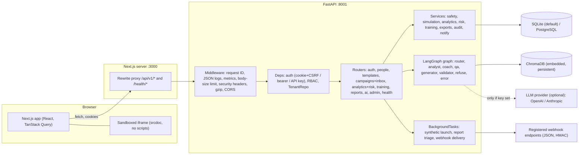
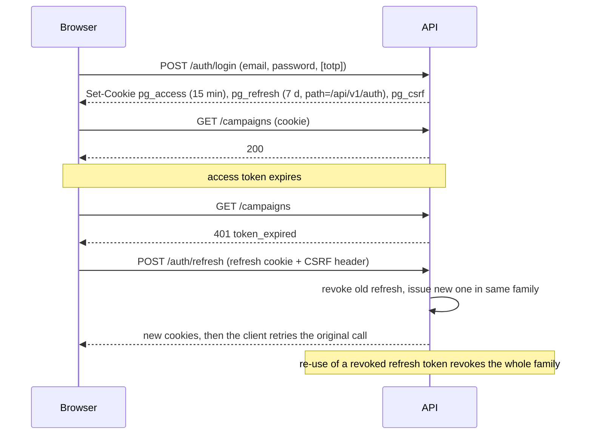
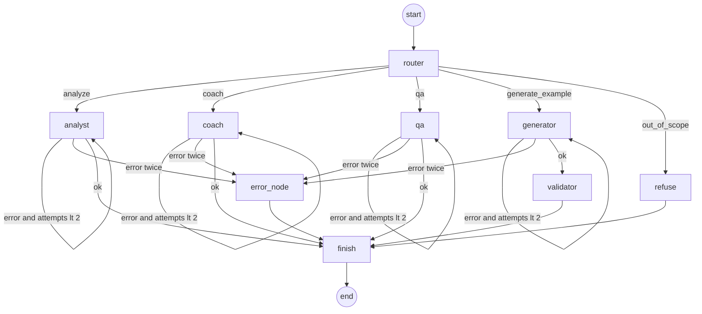
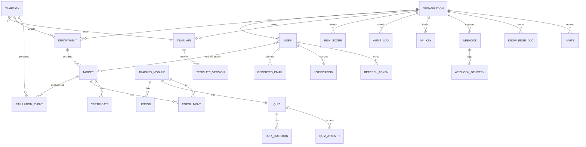

# Architecture

## 1. System overview

Key decisions:

- **One origin for the browser.** The Next.js server proxies `/api/v1/*` to FastAPI. Auth cookies are
  first-party (`SameSite=Lax`, `HttpOnly`), and the backend CORS allow-list is only a fallback.
- **No outbound email path exists.** The only outbound HTTP is (a) webhooks to URLs an admin registered
  and (b) the optional LLM provider.
- **Tenant isolation lives in one place:** `app/db/repository.py`. `TenantRepo` adds
  `WHERE org_id = :org AND deleted_at IS NULL` to every query and refuses to let callers choose `org_id`.

## 2. Request lifecycle (cookie session)

1. The browser sends a request with the `pg_access` cookie. For POST/PATCH/DELETE it also sends the
   `X-CSRF-Token` header, copied from the readable `pg_csrf` cookie.
2. Middleware assigns a request ID, checks body size, and later adds security headers and Prometheus metrics.
3. `get_principal` validates the JWT and checks the `jti` against the revocation list. For cookie auth
   on unsafe methods, it compares the CSRF header to the cookie (constant time).
4. `require_role(min_role, api_scope)` enforces RBAC. API keys pass only on GET endpoints that declare a matching scope.
5. The handler uses `TenantRepo` for every read and write, then calls `audit_p(...)` for mutations
   (who / what / when / IP / request ID).
6. Errors are rendered by `install_error_handlers` as `{"error": {code, message, details}, "request_id"}`.

### JWT flow

## 3. LangGraph multi-agent graph

- **Shared state:** `org_id, user_id, session_id, messages[], demo_mode` plus per-turn working fields
  (`request_type, input, result, error, attempts, usage`).
- **Session memory:** a `MemorySaver` checkpointer keyed by `org_id:user_id:session_id`, so one tenant's
  session can never be read by another. `messages` uses an additive reducer.
- **Guardrail:** every live LLM call goes through `providers.py`, which always prepends `GUARDRAIL_PREFIX`.
  In demo mode the router accepts only the four in-scope request types, and everything else is refused
  with a defensive alternative.
- **Validator node:** checks generated examples for the watermark, an approved fictional brand, red flags
  and subject/body. A failing output is replaced with a known-safe default.
- **Streaming:** `/api/v1/ai/stream` runs the graph and then streams the final text over SSE
  (`meta → token* → result → done`). A live provider could stream tokens directly. This build streams
  the finished output in chunks, which is honest and simple.

| Agent | Live mode | Demo mode |
|---|---|---|
| Indicator Analyst | Rule-based checks, then LLM explains each indicator | Rule-based checks + canned explanation labelled `DEMO — example explanation` |
| Awareness Coach | LLM writes 3 tips from synthetic history | 3 tips from a 12-entry library, weakest category first |
| Knowledge Q&A | Retrieve → LLM answers from `<document>` excerpts only, cites sources | Top retrieved chunk returned verbatim (retrieval-only) |
| Training Example Generator | LLM JSON → validator | One of 5 pre-written fictional examples → validator |

## 4. RAG pipeline

1. Seven original awareness notes live in `backend/app/ai/knowledge/*.md`. They are also stored as `KnowledgeDoc` rows per org.
2. Chunking splits on paragraphs and packs them up to about 700 characters.
3. Embedding uses a deterministic hashing embedder (word unigrams + bigrams, light stemming, 512 dims,
   L2-normalised). It needs no download and no key. The trade-off is lexical, not semantic, matching.
4. The vector store is ChromaDB `PersistentClient` with cosine distance, falling back to an in-memory store.
5. If the top similarity is below `MIN_SIMILARITY = 0.18`, the answer is exactly `not in knowledge base`.
6. **Prompt-injection hardening:** retrieved text is wrapped in `<document>` tags, and the system prompt
   says the excerpts are data, not instructions. In demo mode no LLM reads the text at all.

## 5. Data model (ER)

Every business table carries `org_id` (indexed FK to `organizations`) and `deleted_at` (soft delete).

Indexes cover every FK and filter column, plus composite indexes for the hot analytics paths:
`(org_id, event_type, occurred_at)` and `(campaign_id, target_id)` on events,
`(org_id, created_at)` on the audit log, and `(org_id, scope, subject_id, computed_at)` on risk scores.

## 6. Performance

- **N+1 avoidance:** campaign list stats come from one grouped query (`campaign_stats`). Relationships use
  `joined`/`selectin` loading.
- **Caching:** analytics overview and risk scores are cached per org (TTL 120 s). Every write that changes
  events, campaigns, enrollments or reports calls `cache.invalidate_org(org_id)`.
- **Compression:** GZip middleware for responses over 1 KB.

## 7. SSO readiness

`app/services/oidc.py` defines `OIDCProvider` (`authorization_url`, `exchange_code`). Only
`MockOIDCProvider` is implemented. Its "authorize" step returns a one-time code for a chosen email, and
`/auth/oidc/{provider}/callback` links it to an **existing** active user (no auto-provisioning).

A real IdP (Entra ID, Okta, Google) would implement the same interface:
1. Authorization-code + PKCE.
2. Verify the ID token signature against the IdP JWKS.
3. Check `iss`, `aud`, `nonce` and expiry.
4. Map `email`/`sub` to a user.

SCIM provisioning is not implemented.

## 8. Observability

- **Logs:** structured JSON to stdout (`app/core/logging.py`), with `request_id` on every line. Clients
  can pass `X-Request-ID`, and it is echoed back.
- **Metrics:** `/metrics` (Prometheus) exposes `phishguard_http_requests_total{method,route,status}` and
  `phishguard_http_request_seconds`. Scrape the backend directly; the frontend does not proxy `/metrics`.
- **Tracing hook:** `span()` context manager. Swap it for OpenTelemetry in production.
- **Frontend:** a React error boundary wraps each page, and a toast system shows API errors with their request IDs.
